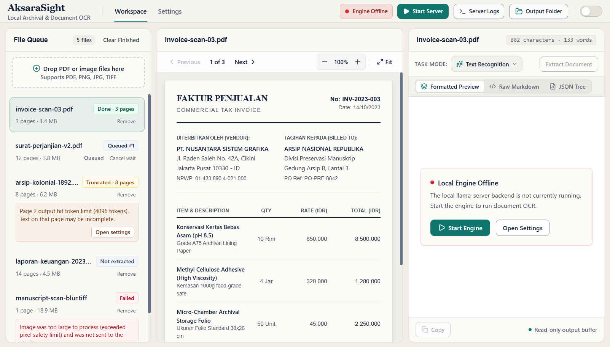
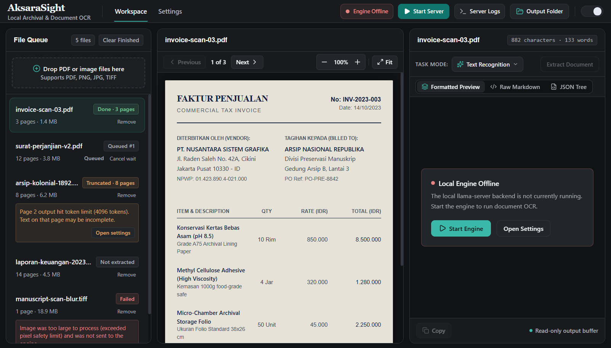
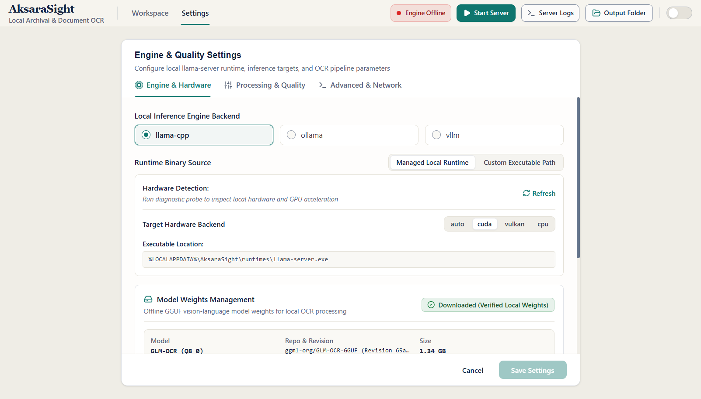
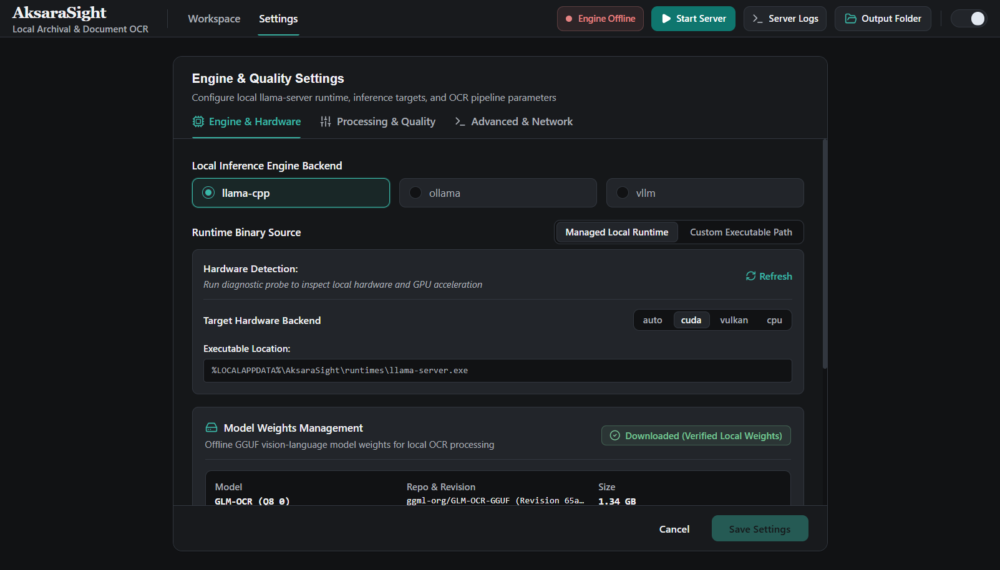
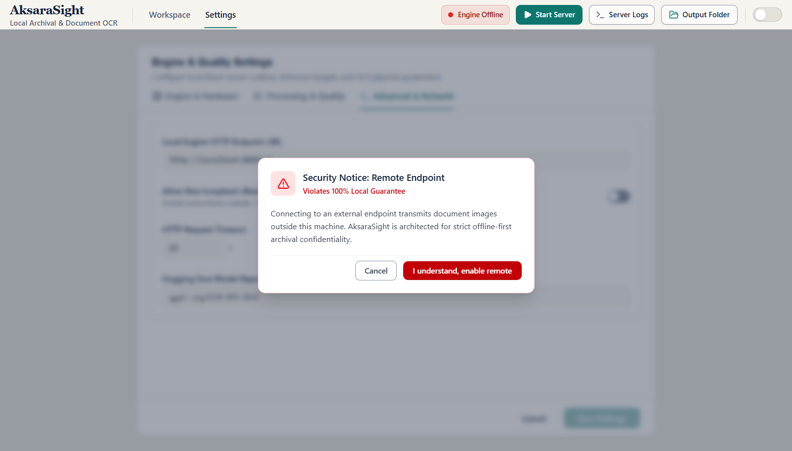

# AksaraSight

[](https://github.com/afif25fradana/AksaraSight/actions/workflows/tests.yml)

AksaraSight is a local OCR workspace running on your computer. It takes scanned documents, PDFs, receipts, or images and converts them into Markdown, Word documents (.docx), or structured JSON.

I built this because most modern OCR tools require uploading files to third-party cloud APIs. If you are scanning tax papers, legal contracts, medical records, or personal notes, sending them off to a remote server is often unacceptable. AksaraSight runs entirely offline using the GLM-OCR model and llama.cpp under the hood. There is no cloud fallback. If the local backend is unreachable, it stops instead of quietly routing your files across the internet.

<p align="center">
  
  
</p>

## What it can do

- **Completely offline**: Everything runs on your machine. Your documents never touch the internet.
- **Export to Word, Markdown, and JSON**: Generates clean `.docx` files with preserved headings and tables, as well as raw `.md` and `.json`.
- **Browser-based workspace interface**: Drag and drop single files or folders to queue them up. You can view the original scan side-by-side with the extracted text, formatted preview, and JSON output.
- **Built-in runtime setup**: You don't need to manually configure llama.cpp or compile CUDA drivers. The app checks your hardware (NVIDIA GPU, Vulkan, or CPU) and downloads the matching build for you.
- **Command-line interface**: If you prefer terminals or want to script batch conversions, you can use the CLI directly.

## Getting Started

### Option 1: Portable Windows Build (No Python needed)

Download the pre-compiled portable zip package from the [Releases](https://github.com/afif25fradana/AksaraSight/releases) page (`AksaraSight-v<version>-windows-x64.zip`). Extract the folder and launch `AksaraSight.exe` to run the Web UI desktop workspace, or use `AksaraSight-CLI.exe` directly from PowerShell or Command Prompt. No Python installation required.

### Option 2: Running from source

If you prefer running from source or want to inspect the code:

Requirements: Windows 10/11 and Python 3.12+ (tested on Python 3.12 & 3.14; 3.14 recommended).

```powershell
git clone https://github.com/afif25fradana/AksaraSight
cd AksaraSight
python -m venv .venv
.\.venv\Scripts\Activate.ps1
pip install -r requirements.txt
python -m web
```

Open your web browser and navigate to `http://127.0.0.1:8000`.

## First run walkthrough

1. Open the application (`python -m web`) and navigate to `http://127.0.0.1:8000`.
2. Click the **Settings** button in the top navigation bar.
3. Under *Runtime Binary Source*, select **Managed Local Runtime** and click **Download Runtime** (or verify the managed local runtime). Under *Model Weights Management*, click **Download Pinned Model** to retrieve the verified GLM-OCR model weights. The app will detect your graphics card (or fall back to CPU) and grab the verified server build.

<p align="center">
  
  
</p>

<p align="center">
  
</p>

4. Click **Start Server** in the navigation bar. Once the status shows `Engine Online`, switch back to **Workspace** and drop a scan or PDF into the drop zone.
5. Check the result in the preview tabs, then click **Export** to save your files.

## A few things to keep in mind

AksaraSight is a personal open-source project with real-world limitations:

- **Hardware and testing**: I built and tested this primarily on my personal laptop (NVIDIA GeForce RTX 3050 6GB Laptop GPU, 16GB RAM). Around 2.2 GB VRAM is recommended for GPU inference; CPU fallback works if you don't have a dedicated GPU, but it is noticeably slower. While the underlying engine includes support for Vulkan as well, I don't own other PCs, laptops, or AMD/Intel graphics cards to test every hardware setup myself. If you run into issues on other hardware, bug reports and feedback are very welcome.
- **First-launch download requirements**: AksaraSight itself is lightweight, but the first launch requires an internet connection to download the local inference engine and weights: ~1.43 GB for the GLM-OCR model weights and between ~35 MB and ~655 MB for the llama.cpp runtime binary depending on your backend (CPU ~47 MB, Vulkan ~35 MB, CUDA ~655 MB including companion CUDA runtime libraries). Once downloaded, all processing is 100% offline.
- **Scan quality and resolution cap**: It handles cleanly printed sheets, forms, and receipts well. Documents and images are automatically normalized and capped to a maximum dimension of 2048px before model inference; this resolution cap has not been exhaustively tested on very high-resolution phone camera photos (e.g., 48MP+ captures). Heavily skewed photos, bad lighting, crumpled paper, or messy handwriting will likely have transcription mistakes.
- **Speed**: On my laptop with an NVIDIA GPU, processing takes about 2 to 3 seconds per page. On CPU, it works reliably, but it takes noticeably longer.
- **Dollar signs and currency formatting**: Standard unspaced amounts (e.g., `$100.00`, `$1,250.00`) transcribe accurately in body text, tables, and receipts. However, in documents with inline formulas or math environments, the model may interpret `$` as a LaTeX delimiter, which can occasionally cause token-spaced formatting like `$ 1 0 0 . 0 0`. If you encounter math spacing in financial scans, verify formulas and currency formatting in the preview.
- **Cancellation**: If you cancel a multi-page job while it is processing, it finishes the current page first so you keep whatever pages were already finished.

## Technical documentation

If you are an engineer looking for CLI flags, environment variables, manual server flags, architecture notes, or the test suite:

Check out [TECHNICAL.md](TECHNICAL.md) for the complete technical manual.

## License

MIT License. See [LICENSE](LICENSE) for details.  
GLM-OCR model weights are subject to the upstream GLM license.