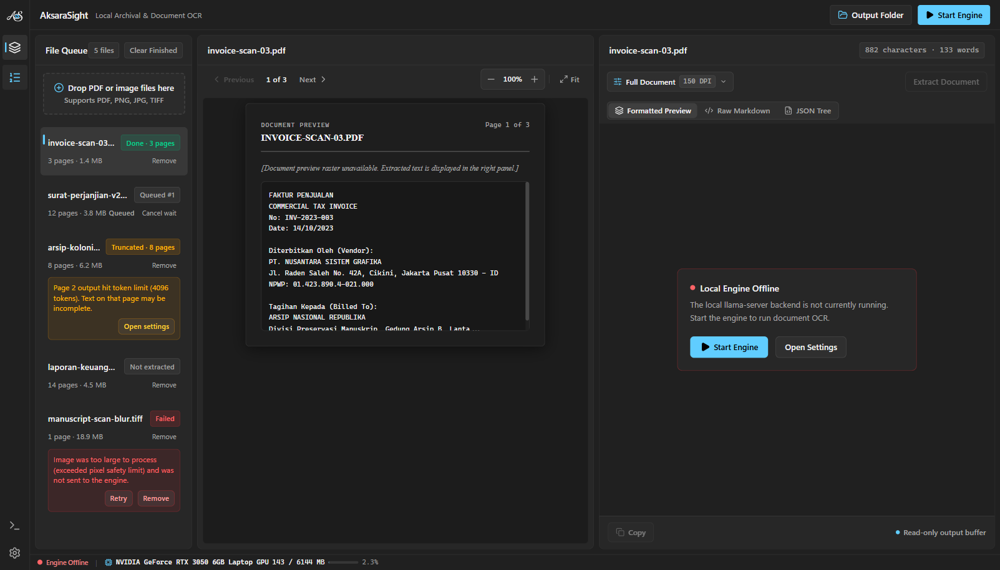
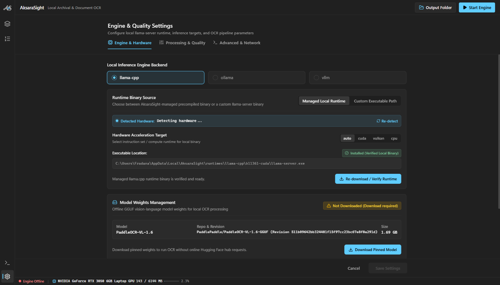
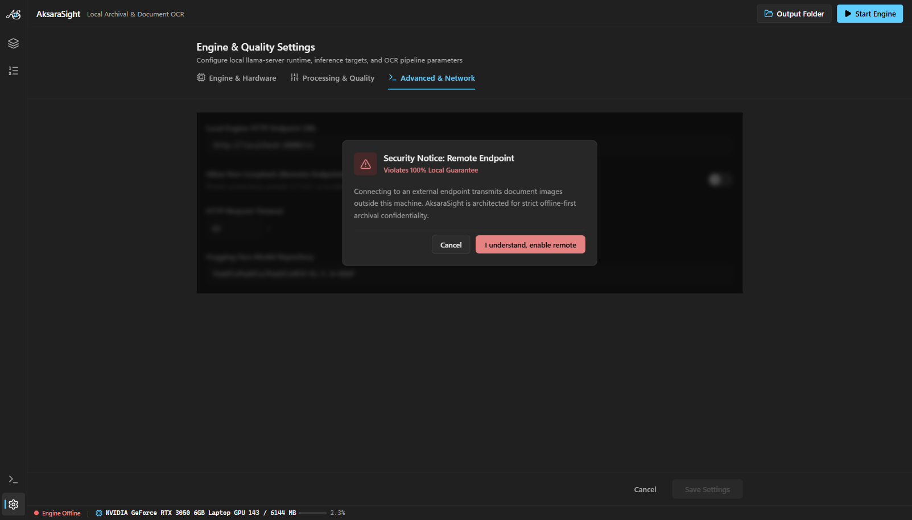

# AksaraSight

[](https://github.com/afif25fradana/AksaraSight/actions/workflows/tests.yml)
[](LICENSE)

AksaraSight is a local, privacy-first OCR workspace for your desktop. It turns scanned documents, PDFs, receipts, and images into clean Markdown, Word documents (.docx), or structured JSON.

I built this because almost every modern OCR tool requires uploading files to someone else's cloud. If you are handling tax returns, legal contracts, medical records, or personal notes, sending sensitive files across the internet is a dealbreaker.

AksaraSight runs inference entirely on your computer using PaddleOCR-VL-1.6 and llama.cpp. Aside from a one-time download of the runtime engine and model weights during first setup, all document processing happens 100% offline. There is no cloud fallback. If the local engine is unreachable, it stops—it will never quietly send your documents anywhere else.

<p align="center">
  
</p>

## What it can do

- **100% private document processing**: After a one-time initial download of the model and runtime, all document processing runs locally on your machine. Your files never touch the internet.
- **Native desktop experience**: Standalone Chromium app-mode window (`--app`) with automatic Server-Sent Events (SSE) connection tracking and shutdown, styled in layered WinUI 3 dark mode with vector iconography.
- **Side-by-side workspace**: Drag and drop single files or entire folders. Inspect original scans alongside raw text, formatted previews, offline KaTeX math rendering, OTSL table structure, or structured JSON.
- **Keyboard-driven workflow**: Keyboard shortcuts for workspace navigation (`Ctrl+1`), settings (`Ctrl+,`), file queue (`Ctrl+B`), and live server logs (`Ctrl+Shift+L`), with focus trapping in dialogs.
- **GPU telemetry & runtime setup**: Live NVML GPU VRAM monitor in the status bar and hardware probing (NVIDIA CUDA, Vulkan, or CPU) that downloads matching runtime binaries.
- **Export to Word, Markdown, and JSON**: Generates clean `.docx` files with preserved headings and tables, as well as raw `.md` and `.json`.
- **Scriptable CLI**: Stream Markdown directly to stdout or batch-process entire directories from PowerShell, Command Prompt, or bash.

## Getting Started

### Option 1: Portable Windows Build (No Python needed)

Download the pre-compiled portable zip package from the [Releases](https://github.com/afif25fradana/AksaraSight/releases) page (`AksaraSight-v<version>-windows-x64.zip`). Extract the folder and launch `AksaraSight.exe` to run the Web UI desktop workspace, or use `AksaraSight-CLI.exe` directly from PowerShell or Command Prompt. No Python installation required (requires standard [Microsoft Visual C++ 2015–2022 Redistributable x64](https://aka.ms/vs/17/release/vc_redist.x64.exe)).

### Option 2: Running from source

Prerequisites: Windows 10/11 or Linux, Python 3.12 or newer, and [Microsoft Visual C++ 2015–2022 Redistributable (x64)](https://aka.ms/vs/17/release/vc_redist.x64.exe) on Windows.

```powershell
git clone https://github.com/afif25fradana/AksaraSight
cd AksaraSight
python -m venv .venv
# On Windows (PowerShell):
.\.venv\Scripts\Activate.ps1
# On Linux / macOS (bash/zsh):
# source .venv/bin/activate
pip install -r requirements.txt
# Optional: pip install -r requirements-dev.txt (for running automated tests)
python -m web
```

Open your web browser and navigate to `http://127.0.0.1:8000`.

## Verified Commands

| Command | Description |
|---|---|
| `python -m web` | Start local Web UI workspace server (default: `http://127.0.0.1:8000`) |
| `python -m web --dev` | Start Web UI in development mode (permits Vite dev server on port 5173) |
| `python -m cli.main <file>` | Run OCR on a single file, streaming Markdown to stdout |
| `python -m cli.main <dir> -o <out> -f docx -r` | Batch convert directory recursively to Word (.docx) files |
| `python -m cli.main --doctor` | Run 5-stage diagnostics check (configuration, hardware, runtime, server, vision probe) |
| `python -m cli.main --detect-hardware` | Probe GPU acceleration and display recommended backend |
| `python -m pytest` | Run backend test suite (unit, functional, integration) |
| `cd frontend && npm test` | Run frontend Vitest test suite |

## First run walkthrough

1. Open the application (`python -m web` or launch `AksaraSight.exe` on Windows). The desktop workspace window opens automatically (or navigate to `http://127.0.0.1:8000`).
2. Open **Settings** via the bottom NavRail gear icon or press `Ctrl+,`.
3. Under *Runtime Binary Source*, select **Managed Local Runtime** and click **Download Runtime** (or verify the managed local runtime). Under *Model Weights Management*, click **Download Pinned Model** to retrieve the verified PaddleOCR-VL-1.6 model weights. The app detects your graphics card (or falls back to CPU) and downloads the verified build.

<p align="center">
  
</p>

<p align="center">
  
</p>

4. Click **Start Engine** in the TopHeader (or press `Ctrl+Shift+L` to inspect live startup logs). Once the status shows `Local Engine Ready` and the status bar displays live NVML VRAM telemetry, switch back to the **Workspace** via the NavRail or `Ctrl+1`.
5. Drop a scan or PDF into the file queue (toggle queue visibility with `Ctrl+B`), select your extraction mode (`OCR:`, `Table Recognition:`, or `Formula Recognition:`), check results across preview tabs (Formatted Text, Math, OTSL Table, or JSON), then click **Export** to save your files.

## A few practical notes

Notes on hardware, speed, and formatting:

- **Hardware and testing**: I built and tested AksaraSight primarily on my personal laptop (NVIDIA GeForce RTX 3050 6GB Laptop GPU, 16 GB RAM). Dedicated GPU inference recommends at least 3.0 GB VRAM to allow display headroom under an 8,192 token context window. Systems with less than 3,000 MB VRAM trigger an advisory pre-flight notice and may require partial CPU offload. CPU fallback works reliably if you don't have a dedicated GPU, but processing takes longer. While the engine also supports Vulkan, I don't own extra test rigs or AMD/Intel graphics cards to verify every hardware combination myself. If you run into quirks on your setup, bug reports and feedback are very welcome!
- **First-launch download**: The app itself is lightweight, but your initial setup needs an internet connection to download the local engine and model weights:
  - **PaddleOCR-VL-1.6 weights**: ~1.82 GB total (`PaddleOCR-VL-1.6-GGUF.gguf` ~936 MB + `PaddleOCR-VL-1.6-GGUF-mmproj.gguf` ~882 MB, pinned revision `511b0964`).
  - **llama.cpp runtime**: ~26 MB for CPU, ~35 MB for Vulkan, or ~655 MB for NVIDIA CUDA.
  Once downloaded, you can disconnect from the internet—all document processing runs 100% offline.
- **Scan quality and image sizing**: Cleanly printed sheets, forms, and receipts parse reliably. Documents are automatically scaled to a 2048px bounding box before inference to protect your system from out-of-memory crashes. Heavily skewed photos, dark shadows, crumpled receipts, or messy handwriting will likely need manual review.
- **Processing speed**: On my laptop GPU (RTX 3050), pages transcribe in about 2 to 3 seconds each. On CPU, it runs reliably, but expect roughly 15 to 30 seconds per page depending on your processor.
- **Specialized prompt modes**: AksaraSight routes document tasks through targeted PaddleOCR-VL-1.6 prompt modes:
  - **Text (`OCR:`)**: Standard transcription for documents, letters, reports, and receipts into clean Markdown and Word (.docx).
  - **Table (`Table Recognition:`)**: Tabular extraction parsing grid layouts into structured OTSL (Open Table Structure Language) with interactive preview.
  - **Formula (`Formula Recognition:`)**: Mathematical equations and expressions rendered offline via KaTeX with LaTeX source preservation.
- **Cancellation**: If you cancel a multi-page job while it is processing, it finishes the current page first so you keep whatever pages were already completed.

## Technical documentation

AksaraSight isolates presentation layers from domain logic. The Web UI and CLI are thin frontends that route document rasterization, image downscaling, and inference streaming through a shared engine (`core/`).

For CLI reference options, environment variable configuration, custom server commands, and packaging scripts, see [TECHNICAL.md](TECHNICAL.md).

## License

MIT License. See [LICENSE](LICENSE) for details.  
PaddleOCR-VL-1.6 model weights are subject to the upstream Apache 2.0 License.
