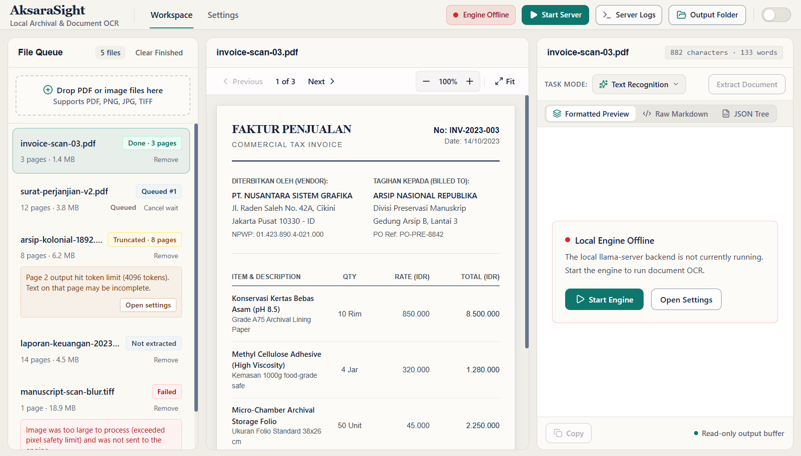
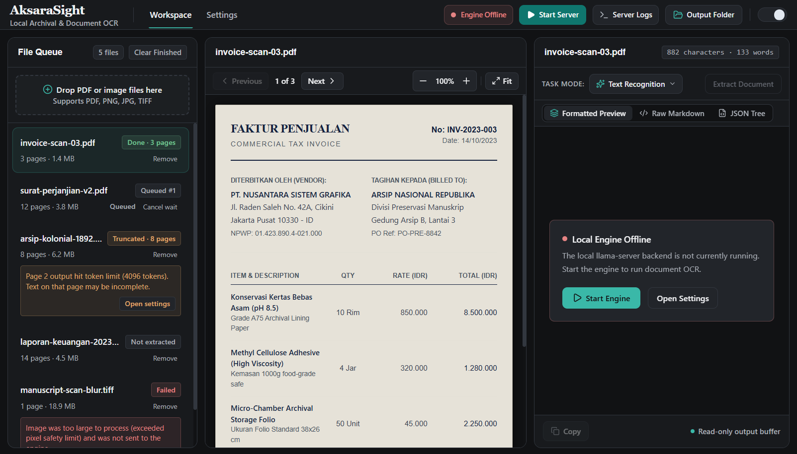
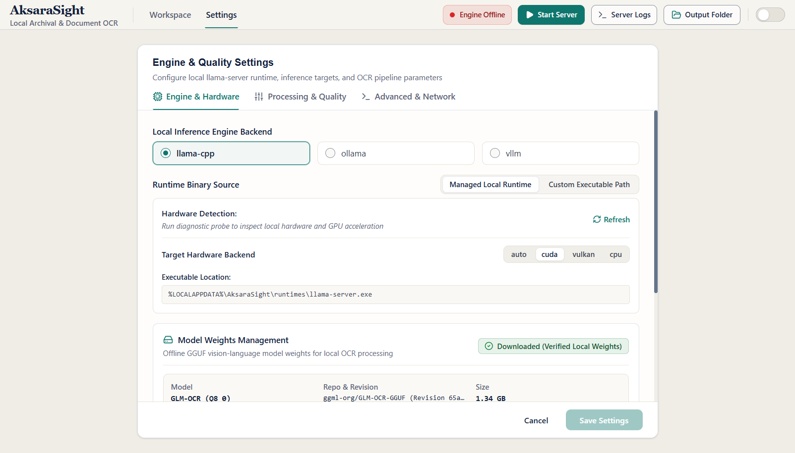
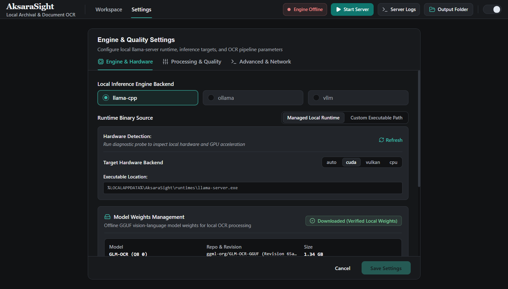
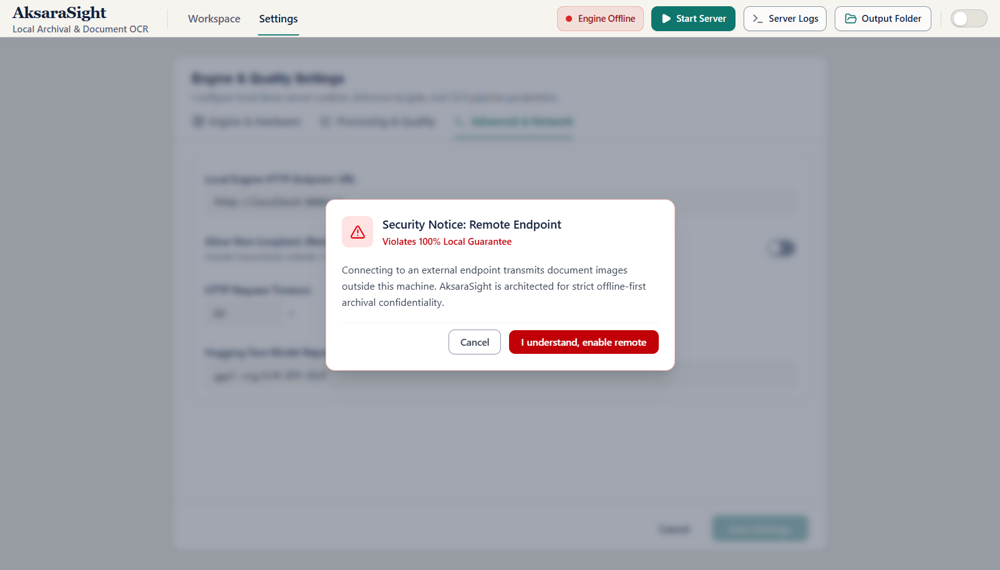

# AksaraSight

[](https://github.com/afif25fradana/AksaraSight/actions/workflows/tests.yml)
[](LICENSE)

AksaraSight is a local, privacy-first OCR workspace for your desktop. It turns scanned documents, PDFs, receipts, and images into clean Markdown, Word documents (.docx), or structured JSON.

I built this because almost every modern OCR tool requires uploading files to someone else's cloud. If you are handling tax returns, legal contracts, medical records, or personal notes, sending sensitive files across the internet is a dealbreaker.

AksaraSight runs inference entirely on your computer using GLM-OCR and llama.cpp. Aside from a one-time download of the runtime engine and model weights during first setup, all document processing happens 100% offline. There is no cloud fallback. If the local engine is unreachable, it stops—it will never quietly send your documents anywhere else.

<p align="center">
  
  
</p>

## What it can do

- **100% private document processing**: After a one-time initial download of the model and runtime, all document processing runs locally on your machine. Your files never touch the internet.
- **Export to Word, Markdown, and JSON**: Generates clean `.docx` files with preserved headings and tables, as well as raw `.md` and `.json`.
- **Side-by-side workspace**: Drag and drop single files or entire folders. Compare the original scan directly against extracted text, a formatted preview, or structured JSON.
- **Automatic runtime setup**: No manual llama.cpp configuration or CUDA driver compilation. AksaraSight probes your hardware (NVIDIA GPU, Vulkan, or CPU) and downloads the right build for you.
- **Scriptable CLI**: Stream Markdown directly to stdout or batch-process entire directories from PowerShell, Command Prompt, or bash.

## Getting Started

### Option 1: Portable Windows Build (No Python needed)

Download the pre-compiled portable zip package from the [Releases](https://github.com/afif25fradana/AksaraSight/releases) page (`AksaraSight-v<version>-windows-x64.zip`). Extract the folder and launch `AksaraSight.exe` to run the Web UI desktop workspace, or use `AksaraSight-CLI.exe` directly from PowerShell or Command Prompt. No Python installation required (requires standard [Microsoft Visual C++ 2015–2022 Redistributable x64](https://aka.ms/vs/17/release/vc_redist.x64.exe)).

### Option 2: Running from source

Prerequisites: Windows 10/11 or Linux, Python 3.12+ (tested on Python 3.12 & 3.14; 3.14 recommended), and [Microsoft Visual C++ 2015–2022 Redistributable (x64)](https://aka.ms/vs/17/release/vc_redist.x64.exe) on Windows.

```powershell
git clone https://github.com/afif25fradana/AksaraSight
cd AksaraSight
python -m venv .venv
# On Windows (PowerShell):
.\.venv\Scripts\Activate.ps1
# On Linux / macOS (bash/zsh):
# source .venv/bin/activate
pip install -r requirements.txt
# Optional: pip install -r requirements-dev.txt (for running automated tests)
python -m web
```

Open your web browser and navigate to `http://127.0.0.1:8000`.

## Verified Commands

| Command | Description |
|---|---|
| `python -m web` | Start local Web UI workspace server (default: `http://127.0.0.1:8000`) |
| `python -m web --dev` | Start Web UI in development mode (permits Vite dev server on port 5173) |
| `python -m cli.main <file>` | Run OCR on a single file, streaming Markdown to stdout |
| `python -m cli.main <dir> -o <out> -f docx -r` | Batch convert directory recursively to Word (.docx) files |
| `python -m cli.main --doctor` | Run 5-stage diagnostics check (configuration, hardware, runtime, server, vision probe) |
| `python -m cli.main --detect-hardware` | Probe GPU acceleration and display recommended backend |
| `python -m pytest` | Run backend test suite (unit, functional, integration) |
| `cd frontend && npm test` | Run frontend Vitest test suite |

## First run walkthrough

1. Open the application (`python -m web`) and navigate to `http://127.0.0.1:8000`.
2. Click the **Settings** button in the top navigation bar.
3. Under *Runtime Binary Source*, select **Managed Local Runtime** and click **Download Runtime** (or verify the managed local runtime). Under *Model Weights Management*, click **Download Pinned Model** to retrieve the verified GLM-OCR model weights. The app will detect your graphics card (or fall back to CPU) and grab the verified server build.

<p align="center">
  
  
</p>

<p align="center">
  
</p>

4. Click **Start Server** in the navigation bar. Once the status shows `Local Engine Ready`, switch back to **Workspace** and drop a scan or PDF into the drop zone.
5. Check the result in the preview tabs, then click **Export** to save your files.

## A few practical notes

Before getting started, here are a few practical expectations regarding hardware, speed, and formatting:

- **Hardware and testing**: I built and tested AksaraSight primarily on my personal laptop (NVIDIA GeForce RTX 3050 6GB Laptop GPU, 16 GB RAM). Dedicated GPU inference requires at least 2.2 GB VRAM (3.0 GB+ recommended for display headroom). CPU fallback works reliably if you don't have a dedicated GPU, but processing takes longer. While the engine also supports Vulkan, I don't own extra test rigs or AMD/Intel graphics cards to verify every hardware combination myself. If you run into quirks on your setup, bug reports and feedback are very welcome!
- **First-launch download**: The app itself is lightweight, but your initial setup needs an internet connection to download the local engine and model weights:
  - **GLM-OCR weights**: ~1.43 GB total (`GLM-OCR-Q8_0.gguf` ~950 MB + `mmproj` ~484 MB).
  - **llama.cpp runtime**: ~26 MB for CPU, ~35 MB for Vulkan, or ~655 MB for NVIDIA CUDA.
  Once downloaded, you can disconnect from the internet—all document processing runs 100% offline.
- **Scan quality and image sizing**: Cleanly printed sheets, forms, and receipts work great. Documents are automatically scaled to a 2048px bounding box before inference to protect your system from out-of-memory crashes. Heavily skewed photos, dark shadows, crumpled receipts, or messy handwriting will likely need manual review.
- **Processing speed**: On my laptop GPU (RTX 3050), pages transcribe in about 2 to 3 seconds each. On CPU, it runs reliably, but expect roughly 15 to 30 seconds per page depending on your processor.
- **Currency formatting and formulas**: Standard currency amounts (e.g., `$100.00`, `$1,250.00`) transcribe accurately in body text and tables. However, in documents that also contain mathematical formulas, the vision model may interpret `$` as a LaTeX math delimiter, producing spaced tokens like `$ 1 0 0 . 0 0`. If your scans mix math and currency, double-check dollar amounts in the preview before exporting.
- **Cancellation**: If you cancel a multi-page job while it is processing, it finishes the current page first so you keep whatever pages were already completed.

## Technical documentation

AksaraSight strictly isolates presentation layers from domain logic. The Web UI and CLI are thin frontends that route all document rasterization, image downscaling, and inference streaming through a shared engine (`core/`).

For CLI reference options, environment variable configuration, custom server commands, and packaging scripts, see [TECHNICAL.md](TECHNICAL.md).

Key architectural design decisions, rejected alternatives, and invariants are documented as Architecture Decision Records in [docs/adr/](docs/adr/).

## License

MIT License. See [LICENSE](LICENSE) for details.  
GLM-OCR model weights are subject to the upstream GLM license.